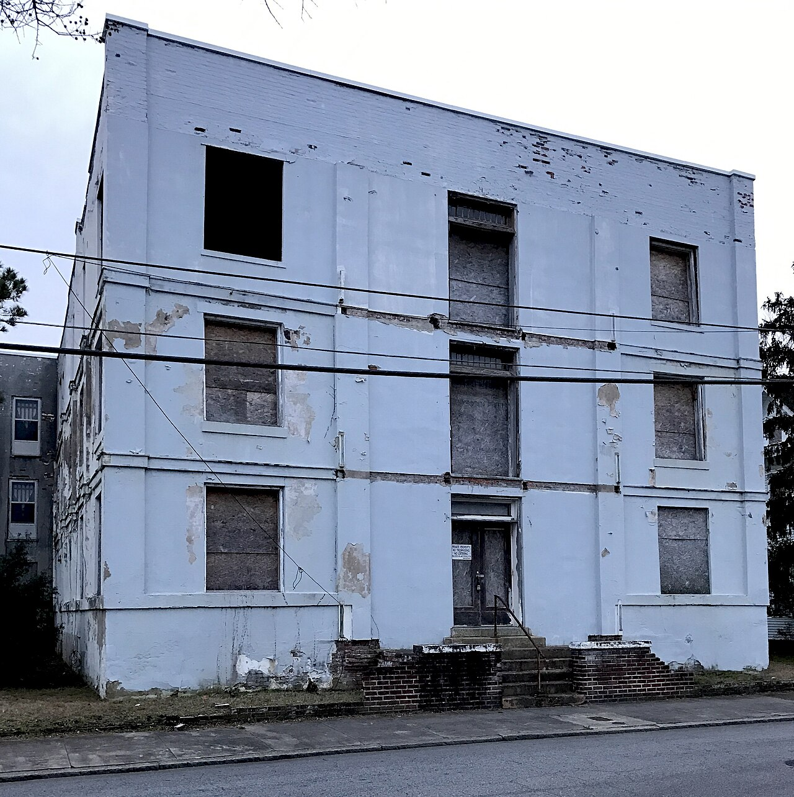

# Fig Tree Court

**Fictional property record · last observed empty: January 2025**

*Illustrative CC0 photo; this is not Fig Tree Court.*

- **Units:** 9 apartments
- **Registered owner:** Bramble Property Circle, an invented company registered in the fictional country of Orvena
- **Other properties attributed to the group:** 7 fictional properties
- **Financing institution:** Common Lantern Credit Union, a fictional lender

The names, ownership, vacancy, and map point are all invented for this example.
